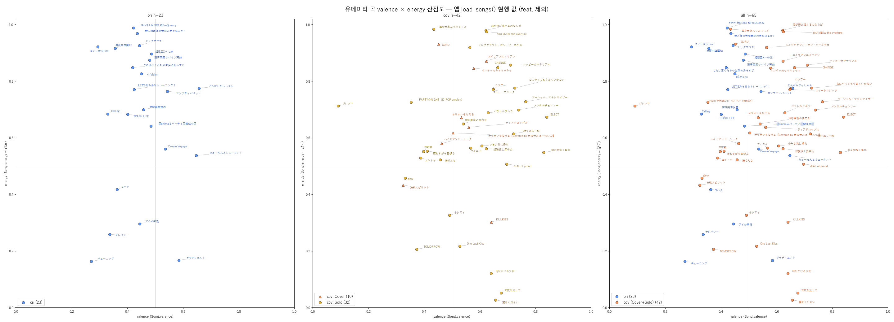
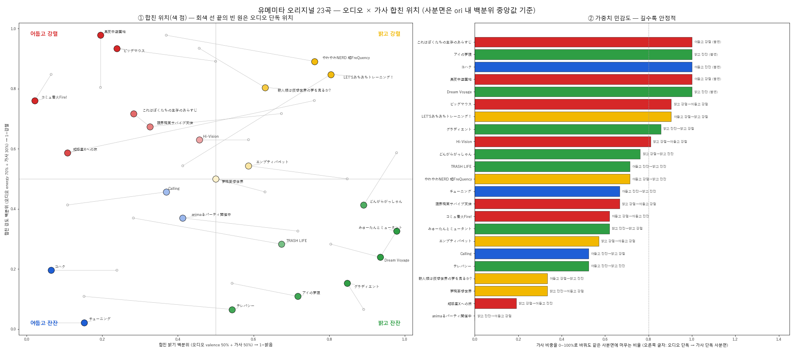
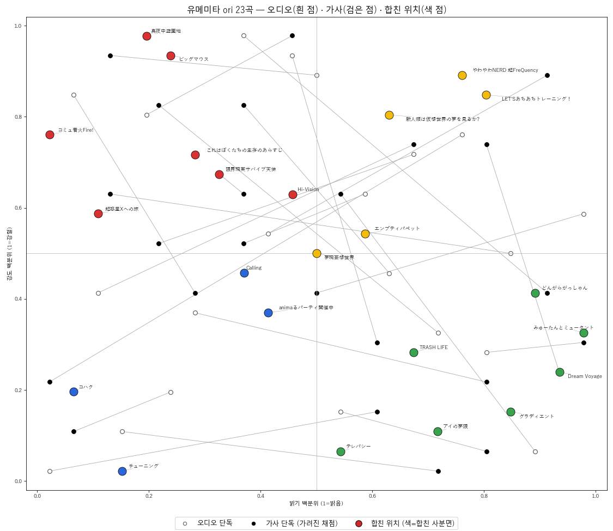
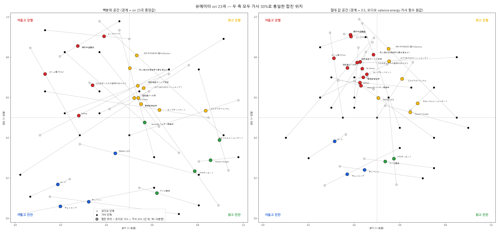

# 유메미타 곡 분포 분석 — 플레이어 팝업용 데이터 조사 보고

> 작성 2026-10-06 · 상태: **조사·분석 단계 (구현 전)**. 이 문서는 유메미타 플레이어(프론트 v4.2.0 「CD + 음표」 버튼의 팝업) 구상을 위해
> BPM 프로젝트의 곡 데이터를 조사한 과정과 결론, 이후 계획을 정리한다. 이 문서의 모든 수치는 아래 「데이터 기준」의 스냅샷에서
> 이번 세션에 직접 계산한 값이며, 기억·추측으로 채운 값은 없다. **확인하지 못한 것은 「확인 필요」로 표시**했다.

## 0. 요약

- BPM 프로젝트(`bandori-playlist-maker` 앱 + `bandori-playlist-maker-data` 데이터)에는 유메미타(`mugendai_mutype`) 곡의 **URL · 길이 · BPM · 키 · 에너지 · valence**가 있고, 출시일은 없어서 **YouTube API로 채웠다**(영상 업로드 시각 기준).
- 대상은 **오리지널(ori) 23곡 + 커버(cov, `(Cover)` 10곡 + `(Solo)` 32곡; `feat.` 곡은 제외) 42곡 = 65곡**.
- 분포도의 **energy는 앱이 현행으로 쓰는 값(`Song.energy`, 강도)**을, valence는 `m6-valence_median`의 min-max 값을 썼다. (처음엔 다른 컬럼을 잘못 써서 정정했다 — §2.)
- 가사 데이터는 **ori 23곡의 한 줄 요약**만 있다(원문 없음, 커버 42곡은 요약도 없음). 요약문을 읽고 밝기·강도를 채점해 오디오 값과 합쳐 봤다.
- 핵심 관찰: ori는 **「어둡지만 강렬」**한 쪽에 몰리고, 오디오와 가사의 **밝기는 거의 무관**(Spearman −0.10), **강도는 약하게만 일치**(0.32)한다. 두 점을 잇는 **선이 길수록 소리와 가사가 엇갈리는 곡**으로 읽을 수 있다.
- 이후 계획: 이 항목을 **LLM 없는 미니 BPM 프로젝트**로 만든다(§7).

## 1. 데이터 기준

| 항목 | 내용 |
|---|---|
| 곡 데이터 | `bandori-playlist-maker-data` 저장소 `origin/data` 브랜치 `data/songs_master.csv` (이번 세션에서 fetch 한 최신 커밋 `532624b`) |
| 값 계산 | `bandori-playlist-maker` 앱의 `src/backend/app/repo/song_repo.py` `load_songs()` 를 그대로 실행해 얻은 `Song.energy`, `Song.valence` |
| 가사 | `data/lyric_impressions.json` (곡별 `desc` 한 줄 요약 + `vec` 임베딩) |
| 출시일 | YouTube Data API `videos.list` 의 `snippet.publishedAt` (UTC, KST 변환 `published_date` 병기). **곡의 공식 발매일이 아니라 그 영상의 업로드 시각** |

- 로컬 `bandori-playlist-maker-data` 작업 트리는 `origin/data` 보다 **33커밋 뒤처져 있어** 신곡이 빠져 있었다. 그래서 작업 트리가 아니라 `origin/data` 의 파일을 직접 꺼내 썼다.
- 유메미타 곡은 최신 데이터에서 **80행**이다. 분류는 곡명 표기 기준이다:

| 구분 | 곡 수 | 비고 |
|---|---|---|
| ori | 23 | `idx` 237~259 |
| Cover | 10 | 곡명 `(Cover)` — 신규 `オリオンをなぞる` 2버전 포함 |
| Solo | 32 | 곡명 `(Solo)` |
| feat. | 6 | **이번 분석에서 제외**(운영자 결정) |
| 미분류 | 9 | 표기 없음: `Face The Next`, `TearJerker`, `一番のひかり`, `うちゅうのふしぎ`, `夢はトゥルーエンド！`, `in my words`, `愛は衝動`, `にこいちミライ`, `夢我夢中` — **ori 인지 아닌지 운영자 확인 필요** |

- 업로드 시각 범위(65곡): 2023-11-28 ~ 2026-09-23. ori 23곡은 모두 `Mugendai MewType - Topic` 채널(음원 자동 생성 영상) 업로드라 날짜는 음원 유통 시점에 가깝다.
- 채널 업로드를 직접 세어 보면 제목에 `Cover`·`歌ってみた`·`Solo`·`feat` 가 들어간 영상이 **65개**지만 BPM 데이터에는 그중 43개만 있고 22개는 없다(쇼츠·노래방 클립 17개 안팎과, 데이터 수집 이후의 신곡 일부로 보임 — **정확한 누락 사유는 확인 필요**). 여기서 65라는 숫자는 분석 대상 65곡과 우연히 같은 값이며 서로 다른 집합이다.

## 2. 값 선택 과정과 정정

1. 처음에 `songs_master.csv` 의 **`energy` 컬럼**으로 분포도를 그렸다. 하지만 이 컬럼은 EMOI-MAP 펄스용이고 발췌 구간만 반영해 앱 코드 주석에도 선곡용으로 부적합("오판")하다고 적혀 있다 → **폐기**.
2. 앱의 **현행 `Song.energy`** 는 `energy_full`, `acousticness_proxy` 백분위, `i_min`·`i_mean`·`i_end` 백분위를 power-mean(p=3)으로 합친 "무드 강도"(0~1)이다. 선곡 엔진이 쓰는 값이 이것이다. 이후 모든 그림은 이 값 기준.
3. **valence** = `m6-valence_median` 을 앱 eligible 풀 기준 min-max(0~1)한 값. 유메미타 곡은 이 풀에서 좁은 구간(ori 0.27~0.66)에 몰린다.
4. 커버 분류를 처음에 `(Cover)` 8곡만으로 잡아 대부분이 빠졌다 → `(Solo)` 포함, `feat.` 제외로 정정(운영자 지시). 로컬 데이터 저장소가 오래돼 있던 것도 이때 발견.

## 3. 오디오 분포 (ori + cov 65곡)

0.5 기준선으로 나눈 사분면(각 값은 `songs_master` 지표 평균):

| 분면 | 곡 수 | ori / Cover / Solo | BPM | 댄서빌리티 | LUFS | 특징 |
|---|---|---|---|---|---|---|
| 밝고 강렬 | 28 | 4 / 6 / 18 | 121 | 0.68 | −12.9 | 대부분 커버·Solo |
| 어둡고 강렬 | 23 | 14 / 2 / 7 | 123 | 0.42 | −11.5 | **ori 23곡 중 14곡**, 유닛 대표곡들 |
| 밝고 잔잔 | 6 | 1 / 1 / 4 | 125 | 0.63 | −13.0 | 곡이 가장 적음 |
| 어둡고 잔잔 | 8 | 4 / 1 / 3 | 118 | 0.41 | −12.3 | 어쿠스틱 지표 최고, arousal 최저 |

- 수치: ori energy 평균 0.68 · valence 평균 0.45 / cov energy 평균 0.61 · valence 평균 0.56. cov 가 valence 폭이 더 넓다(0.09~0.84).
- 분면 이름은 이 문서에서 임시로 붙인 해석이다. (장·단조 비율이 분면 분위기와 일치하지 않는 이유는 **확인 필요** — `m3-mode` 는 참고용.)

## 4. 가사 데이터와 채점

- 가사 요약(`desc`)은 **ori 23곡에만** 있고 커버 42곡에는 없다. 가사 원문은 어디에도 보관하지 않는다. 요약의 생성 방식은 **확인하지 않았다**.
- ori 23곡의 요약문을 읽고 **밝기**(0=어두움 → 1=밝음)와 **강도**(0=잔잔 → 1=강렬)를 0~1 로 채점했다.
- **오염 문제와 정정**: 1차 채점은 요약문을 오디오 값과 같은 화면에서 보며 매겨, 강도가 오디오 energy 와 Spearman 0.81 로 나왔다. 이는 오디오 값의 영향으로 과대 → **오디오·곡명을 가리고 곡 순서를 섞은 요약문만 별도 에이전트에 주어 재채점**했다(1회 채점, 재현성은 **확인 안 함**).

| 축 | 오디오 vs 1차(오염) | 오디오 vs **가려진 재채점** | 1차 vs 재채점 |
|---|---|---|---|
| 밝기 | 0.07 | **−0.10** (p=0.64) | 0.92 |
| 강도 | 0.81 | **0.32** (p=0.13) | 0.66 |

→ 이후 합성엔 **가려진 재채점**만 사용. 오염된 1차 점수 기준 그림은 폐기해 이 문서에 싣지 않았다.

- 한계: 한 줄 요약 기반이라 정밀도가 낮고, 요약문 12/23곡에 긍정어(`희망`·`꿈`·`사랑` 등)가 있어 **가사 밝기가 긍정 쪽으로 기울 가능성**이 있다(잔잔한 곡의 가사 밝기 평균 0.60 vs 강렬한 곡 0.43).

## 5. 오디오 × 가사 합치기

### 5-1. 1차 시도 (폐기)

각 축을 z-score 후 가중합(밝기 가사 50%, 강도 가사 30%)하고 ori 23곡 내 백분위로 변환했다.

문제 둘이 확인됐다.

1. **합친 점이 흰 점(오디오)–검은 점(가사)을 잇는 선 위에 있지 않았다**(23곡 중 15곡이 선에서 0.05 이상 벗어남). 원인: 축마다 비중이 달랐고(밝기 50%·강도 30%), 합친 뒤 백분위로 한 번 더 바꿔 비선형이 됐기 때문.
2. **잔잔한 곡이 대부분 밝은 쪽(4사분면)으로 몰렸다**(합친 기준 잔잔 11곡 중 7곡이 밝음). 원인: ① 가사 밝기가 잔잔한 곡에서 높게 나옴, ② 경계를 ori 23곡 백분위 중앙값으로 잡아, 에너지가 높은 쪽으로 치우친 ori 에서 중간 에너지(0.70 이하) 곡까지 "잔잔"이 됨. 절대 기준(energy<0.5)으로는 잔잔한 ori 가 5곡뿐이고 그중 4곡이 어두운 쪽.

(1차 그림의 민감도 패널은 두 축에 같은 비중을 줘서 돌린 값이라 실제 기본 설정과 달라 참고용이다.)

### 5-2. 현행안 (두 축 가사 30% 통일)

합친 위치 = **오디오 70% + 가사 30% 의 선형 가중 평균**이라 항상 두 점을 잇는 선 위에 놓인다. 경계 기준이 미정이라 두 공간으로 그렸다 — 왼쪽: ori 내 백분위(경계 = 중앙값), 오른쪽: 절대 값(경계 = 0.5).

| 합친 사분면 | 백분위 공간 | 절대 값 공간 |
|---|---|---|
| 밝고 강렬 | 9 | 6 |
| 어둡고 강렬 | 5 | 12 |
| 밝고 잔잔 | 5 | 2 |
| 어둡고 잔잔 | 4 | 3 |

- 절대 값 공간은 잔잔한 곡의 분류가 운영자 인상(`チューニング`·`テレパシー`·`コハク` 가 어둡고 잔잔)과 맞지만 한쪽(어둡고 강렬 12곡)으로 몰린다. 백분위 공간은 균형은 맞으나 잔잔한 곡이 밝은 쪽으로 몰리는 문제가 남는다. **경계 기준은 미정.**
- 절대 값 공간에서 `アイの夢限` 은 합친 밝기가 약 0.54 로 경계에 걸친다(z-score 로 퍼짐을 맞춘 별도 시험에서는 어둡고 잔잔이었음) → 단정 불가.

## 6. 해석: 선 길이와 중심 원

운영자의 가정(정성적): **선이 길수록 듣는 사람마다 곡을 다르게 받아들이기 쉽고, 짧을수록 누가 들어도 비슷한 느낌**이다. 중심 (0.5, 0.5) 에 반지름 **r=0.1** 원을 두고, 선이 원에 닿는 곡은 중립을 지나므로 받아들임이 갈리기 쉽고, 닿지 않는 곡은 누가 들어도 비슷한 느낌(강렬/잔잔, 밝음/어두움)이라고 본다.

- 이 가정은 **실제 청취자 평가 없이는 검증할 수 없다**(지금 가진 건 모델 값과 요약문 점수뿐).
- 선이 원에 닿는 곡: **백분위 공간 8곡 / 절대 값 공간 5곡**. 두 공간 모두 닿는 곡은 `どんがらがっしゃん`, `新人類は仮想世界の夢を見るか?` 2곡.
- **주의 — 닿는 것은 두 경우가 섞여 있다.** (a) 두 점이 모두 중심 근처인 "중립형", (b) 두 점이 서로 먼 다른 사분면에 있고 그 사이를 잇는 선이 중심을 지나는 "엇갈림형". 닿는 곡 대부분이 (b)였다(백분위 8곡 전부, 절대 값 5곡 중 4곡). (b)는 중립이 아니라 소리와 가사가 엇갈린 곡이다.
- 선 길이(절대 값 공간)의 중앙값 0.34, 최소 0.06(`夢現妄想世界`), 최대 0.65(`やわやわNERD 超FreQuency`). 두 공간의 길이 순위 상관은 0.53 에 그친다 — 곡끼리 상대 비교용이고 절대 기준은 따로 필요.
- 가로 방향(밝기) 차이 평균 0.22, 세로(강도) 0.21.
- y축(강렬/잔잔)이 아닌 **x축(밝다/어둡다)** 의 표현을 `신난다/진지하다` 로 바꾸자는 의견이 있다(§7).

### ori 23곡 값 (두 점 + 합친 사분면 + 선 길이 + 원 접촉)

오디오·가사 열은 `밝기(valence) / 강도(energy)` 순. 접촉 ●: 선이 r=0.1 원에 닿음.

| idx | 곡 | 오디오 | 가사(재채점) | 합친 사분면(백분위) | 합친 사분면(절대) | 선 길이(절대) | 접촉(백분위) | 접촉(절대) |
|---|---|---|---|---|---|---|---|---|
| 237 | アイの夢限 | 0.44 / 0.30 | 0.75 / 0.25 | 밝고 잔잔 | 밝고 잔잔 | 0.31 | – | – |
| 238 | どんがらがっしゃん | 0.66 / 0.78 | 0.50 / 0.50 | 밝고 강렬 | 밝고 강렬 | 0.32 | ● | ● |
| 239 | みゅーたんとミュータント | 0.65 / 0.54 | 0.75 / 0.65 | 밝고 잔잔 | 밝고 강렬 | 0.15 | – | – |
| 240 | チューニング | 0.27 / 0.16 | 0.60 / 0.35 | 어둡고 잔잔 | 어둡고 잔잔 | 0.38 | – | – |
| 241 | Dream Voyage | 0.54 / 0.56 | 0.90 / 0.45 | 밝고 잔잔 | 밝고 강렬 | 0.38 | – | ● |
| 242 | グラディエント | 0.58 / 0.17 | 0.55 / 0.60 | 밝고 잔잔 | 밝고 잔잔 | 0.43 | – | ● |
| 243 | LET'Sあちあちトレーニング！ | 0.42 / 0.77 | 0.85 / 0.80 | 밝고 강렬 | 밝고 강렬 | 0.43 | ● | – |
| 244 | 真夜中遊園地 | 0.36 / 0.92 | 0.45 / 0.90 | 어둡고 강렬 | 어둡고 강렬 | 0.10 | – | – |
| 245 | テレパシー | 0.34 / 0.26 | 0.70 / 0.20 | 어둡고 잔잔 | 어둡고 잔잔 | 0.37 | – | – |
| 246 | TRASH LIFE | 0.40 / 0.68 | 0.75 / 0.40 | 어둡고 잔잔 | 밝고 강렬 | 0.45 | – | ● |
| 247 | 新人類は仮想世界の夢を見るか? | 0.44 / 0.97 | 0.60 / 0.45 | 밝고 강렬 | 어둡고 강렬 | 0.54 | ● | ● |
| 248 | コミュ着火Fire! | 0.29 / 0.92 | 0.35 / 0.50 | 어둡고 강렬 | 어둡고 강렬 | 0.43 | – | – |
| 249 | Calling | 0.33 / 0.68 | 0.65 / 0.65 | 어둡고 강렬 | 어둡고 강렬 | 0.32 | – | – |
| 250 | Hi-Vision | 0.45 / 0.83 | 0.40 / 0.55 | 밝고 강렬 | 어둡고 강렬 | 0.28 | ● | – |
| 251 | コハク | 0.36 / 0.42 | 0.20 / 0.30 | 어둡고 잔잔 | 어둡고 잔잔 | 0.20 | – | – |
| 252 | ✞animaるパーティ✞開催中✞ | 0.48 / 0.64 | 0.30 / 0.70 | 밝고 잔잔 | 어둡고 강렬 | 0.19 | ● | – |
| 253 | エンプティパペット | 0.54 / 0.76 | 0.25 / 0.60 | 밝고 강렬 | 어둡고 강렬 | 0.34 | ● | – |
| 254 | 限界現実サバイブ天使 | 0.48 / 0.87 | 0.30 / 0.55 | 밝고 강렬 | 어둡고 강렬 | 0.37 | – | – |
| 255 | ビッグマウス | 0.44 / 0.93 | 0.25 / 0.85 | 어둡고 강렬 | 어둡고 강렬 | 0.21 | – | – |
| 256 | 夢現妄想世界 | 0.46 / 0.70 | 0.40 / 0.70 | 밝고 강렬 | 어둡고 강렬 | 0.06 | ● | – |
| 257 | やわやわNERD 超FreQuency | 0.42 / 0.99 | 0.85 / 0.50 | 밝고 강렬 | 밝고 강렬 | 0.65 | – | – |
| 258 | 超惑星Xへの旅 | 0.49 / 0.90 | 0.10 / 0.40 | 밝고 강렬 | 어둡고 강렬 | 0.63 | ● | – |
| 259 | これはぼくたちの生存のあらすじ | 0.42 / 0.85 | 0.40 / 0.60 | 어둡고 강렬 | 어둡고 강렬 | 0.25 | – | – |

## 7. 이후 계획 — LLM 없는 미니 BPM 프로젝트

운영자 계획: 이 항목(곡 분포 · 사분면 · 괴리 표시)을 **LLM 을 쓰지 않는 미니 BPM 프로젝트**로 만든다. 플레이어 팝업이 쓰는 곡 데이터 소스가 된다.

정해진 것은 위 방향뿐이고, 아래는 **이 조사에서 드러난 결정 필요 사항 / 작업 후보**다(확정 아님).

**결정 필요**

1. **가사 점수 확보 방법** — 현재 ori 가사 점수는 (요약문 생성) + (LLM 채점)에 의존한다. LLM 없이 가려면 대체 수단이 필요하다(예: 확정된 점수를 정적 데이터로 고정). 방법은 **미정 / 확인 필요**. 커버 42곡은 가사 데이터가 아예 없다.
2. **사분면 경계 기준** — 백분위(균형) vs 절대 0.5(운영자 인상과 일치, 한쪽으로 몰림), 또는 절충. §5-2.
3. **x축 이름** — `밝다/어둡다` 를 `신난다/진지하다` 로 바꾸는 안(운영자). 이름을 바꾸면 가사 점수도 같은 기준으로 **다시 가려진 채점**을 해야 한다. 오디오 맵(`audio_map.json`)의 축 설명이 이미 `발랄한 느낌 ↔ 진지한 느낌`이라 오디오 쪽과는 맞는다.
4. **미분류 9곡의 ori 여부**, `feat.` 곡을 최종적으로 계속 제외할지.
5. **합친 위치와 괴리 지표 정의** — 오디오 70% + 가사 30% 가중치의 근거가 약하다(강도 일치가 0.32 로 낮음). 가사 비중을 낮추거나 밝기에만 쓰는 안 포함. 선 길이를 "괴리 지수"로 쓴다면 가로·세로 성분으로 분해해 정의하는 것을 제안.

**작업 후보**

- 곡 목록을 정적 JSON 으로 고정(출처: `data/songs_release.json`, 아래 부록) — 프론트 `docs/SPEC.md` 계약과 맞출 형식은 미정.
- 신곡 반영 방식(BPM 데이터 `origin/data` 는 자동 반영되지만 이 스케줄러 저장소와의 동기화 방법은 **미정**).
- 오디오 지표의 곡별 값이 `[auto]` 보강 커밋으로 갱신되므로 스냅샷 시점 표기 필요.
- 팝업 UI 설계(별도 작업).

## 8. 한계 정리

- 가사 점수는 한 줄 요약에서 에이전트 1회 채점한 값(재현성 미확인, 요약 생성 방식 미확인)이다.
- 합친 위치는 ori 23곡에서만 의미가 있다(커버는 가사 데이터 없음).
- valence 는 앱 eligible 풀 기준 상대값이라 절대적인 "밝음"이 아니다.
- 사분면 이름·해석, 선 길이 = 받아들임 갈림 가정은 이 문서의 해석이지 검증된 사실이 아니다.
- 출시일은 영상 업로드 시각이며 토픽 채널 음원은 공식 뮤직비디오 공개일과 다를 수 있다. 공식 채널 MV 날짜로 바꾸려면 추가 조회(쿼터)가 필요하다.

## 부록 A. 산출물

| 파일 | 내용 |
|---|---|
| `figs/energy_valence_scatter.png` | 65곡 valence × energy 산점도 (ori / cov / all) |
| `figs/ori_audio_vs_lyric.png` | 1차 합성: 오디오·가사·합친 위치 (§5-1, 폐기안) |
| `figs/ori_fused.png` | 1차 합성 + 가중치 민감도 (§5-1, 폐기안) |
| `figs/ori_fused_v2.png` | 현행안: 두 축 가사 30% 통일, 백분위/절대 값 두 공간 (§5-2) |
| `data/songs_release.json` | ori+cov 65곡: 곡명·URL·BPM·키·energy·valence·업로드 시각·채널 |
| `data/ori_fused.json` | ori 23곡: 오디오·가려진 가사 점수·합친 사분면(두 공간) |

## 부록 B. ori+cov 65곡 (업로드 순)

energy·valence 는 앱 `Song` 값. 업로드 채널은 `data/songs_release.json` 참고.

| idx | 곡 | 구분 | 업로드(KST) | energy | valence | BPM | 키 | 영상 |
|---|---|---|---|---|---|---|---|---|
| 693 | 君が飛び降りるのならば | Solo | 2023-11-28 | 0.98 | 0.62 | 103 | D#maj | [BI71vana4VI](https://youtu.be/BI71vana4VI) |
| 703 | ユキトキ | Solo | 2023-12-08 | 0.53 | 0.39 | 112 | Fmin | [LXYyBjnbQys](https://youtu.be/LXYyBjnbQys) |
| 721 | CH4NGE | Solo | 2023-12-15 | 0.85 | 0.66 | 118 | D#maj | [ivfYQxQBiXQ](https://youtu.be/ivfYQxQBiXQ) |
| 720 | PARTY☆NIGHT（D-POP version） | Solo | 2023-12-22 | 0.73 | 0.35 | 144 | F#maj | [tdZgnk1nEG4](https://youtu.be/tdZgnk1nEG4) |
| 708 | 決戦スピリット | Cover | 2023-12-28 | 0.43 | 0.32 | 96 | D#maj | [i-cgqBosaDw](https://youtu.be/i-cgqBosaDw) |
| 722 | 絶え間なく藍色 | Solo | 2024-01-21 | 0.55 | 0.83 | 123 | Gmin | [bLIW2klD4Ms](https://youtu.be/bLIW2klD4Ms) |
| 719 | TOMORROW | Solo | 2024-01-26 | 0.21 | 0.37 | 108 | Fmaj | [_WXK_IB4cck](https://youtu.be/_WXK_IB4cck) |
| 709 | ティアドロップス | Cover | 2024-02-07 | 0.64 | 0.56 | 129 | Bmin | [gZe2UGwld2E](https://youtu.be/gZe2UGwld2E) |
| 704 | スイートマジック | Solo | 2024-02-14 | 0.77 | 0.65 | 123 | G#maj | [PsPtBzaevyA](https://youtu.be/PsPtBzaevyA) |
| 694 | 地球最後の告白を | Solo | 2024-02-26 | 0.65 | 0.54 | 96 | A#maj | [7R1DMU0qa00](https://youtu.be/7R1DMU0qa00) |
| 705 | 少年よ我に帰れ | Solo | 2024-04-17 | 0.57 | 0.61 | 118 | Dmin | [2TtYsm1HDx8](https://youtu.be/2TtYsm1HDx8) |
| 695 | パラレルラルラ | Solo | 2024-04-19 | 0.69 | 0.63 | 129 | C#maj | [ZcY2a1DyVAo](https://youtu.be/ZcY2a1DyVAo) |
| 718 | 時をかける少女 | Solo | 2024-04-26 | 0.12 | 0.64 | 129 | F#min | [XEzZRDCZBSc](https://youtu.be/XEzZRDCZBSc) |
| 723 | 撫でんな | Solo | 2024-05-03 | 0.52 | 0.46 | 144 | Gmaj | [tZzToEEZjgo](https://youtu.be/tZzToEEZjgo) |
| 710 | ロウワー | Cover | 2024-05-10 | 0.77 | 0.65 | 129 | Fmin | [FhaynKrmQro](https://youtu.be/FhaynKrmQro) |
| 666 | インキャのキャキャキャ | Cover | 2024-05-19 | 0.85 | 0.58 | 118 | F#min | [_jU3f42nbGs](https://youtu.be/_jU3f42nbGs) |
| 696 | 夜もすがら君想ふ | Solo | 2024-05-24 | 0.55 | 0.41 | 99 | A#maj | [OsJPJo4uKBc](https://youtu.be/OsJPJo4uKBc) |
| 717 | ハッピー☆マテリアル | Solo | 2024-06-07 | 0.86 | 0.71 | 108 | D#maj | [yLj0VCQC8qE](https://youtu.be/yLj0VCQC8qE) |
| 697 | ジレンマ | Solo | 2024-06-15 | 0.71 | 0.09 | 123 | Fmin | [3M5YaHlpMjY](https://youtu.be/3M5YaHlpMjY) |
| 724 | なにやってもうまくいかない | Solo | 2024-06-29 | 0.78 | 0.73 | 123 | Emin | [9Ba8G_i4dAg](https://youtu.be/9Ba8G_i4dAg) |
| 698 | glow | Solo | 2024-07-06 | 0.46 | 0.33 | 172 | Amaj | [WS4flpVYkLg](https://youtu.be/WS4flpVYkLg) |
| 716 | 元気を出して | Solo | 2024-07-20 | 0.05 | 0.68 | 92 | Cmaj | [RzgsdgCkFjU](https://youtu.be/RzgsdgCkFjU) |
| 699 | メンタルチェンソー | Solo | 2024-07-27 | 0.70 | 0.74 | 123 | Dmin | [eI-BW0Bcq4g](https://youtu.be/eI-BW0Bcq4g) |
| 711 | ハイドアンド・シーク | Cover | 2024-08-11 | 0.58 | 0.46 | 136 | Emin | [FvLSUJ35qmE](https://youtu.be/FvLSUJ35qmE) |
| 700 | ホシアイ | Solo | 2024-08-16 | 0.33 | 0.49 | 162 | Fmaj | [d6n4WHEtAgE](https://youtu.be/d6n4WHEtAgE) |
| 725 | マーシャル・マキシマイザー | Solo | 2024-08-23 | 0.73 | 0.76 | 96 | F#maj | [Gc7vzpnIYSU](https://youtu.be/Gc7vzpnIYSU) |
| 668 | エイリアンエイリアン | Cover | 2024-09-14 | 0.87 | 0.62 | 144 | C#min | [QmYpqqTvVHc](https://youtu.be/QmYpqqTvVHc) |
| 715 | 翼をください | Solo | 2024-09-19 | 0.03 | 0.66 | 162 | Fmaj | [RGByUSGhQgE](https://youtu.be/RGByUSGhQgE) |
| 701 | フォニイ | Solo | 2024-10-20 | 0.56 | 0.57 | 112 | F#min | [0makuFTnChs](https://youtu.be/0makuFTnChs) |
| 247 | 新人類は仮想世界の夢を見るか? | ori | 2024-10-27 | 0.97 | 0.44 | 118 | Emin | [zFsTGz60TLY](https://youtu.be/zFsTGz60TLY) |
| 726 | ZEAL of proud | Solo | 2024-11-05 | 0.51 | 0.70 | 129 | D#min | [4MPXhnbf29o](https://youtu.be/4MPXhnbf29o) |
| 712 | 不可解 | Solo | 2024-12-01 | 0.55 | 0.40 | 136 | Fmaj | [YHfBJMxWSec](https://youtu.be/YHfBJMxWSec) |
| 706 | One Last Kiss | Solo | 2024-12-18 | 0.22 | 0.53 | 112 | C#min | [fyc4aGZ9C18](https://youtu.be/fyc4aGZ9C18) |
| 248 | コミュ着火Fire! | ori | 2024-12-24 | 0.92 | 0.29 | 99 | Fmin | [SI8q0trRdOE](https://youtu.be/SI8q0trRdOE) |
| 692 | YoU kNOw the overture | Solo | 2024-12-26 | 0.97 | 0.62 | 118 | Amin | [UWHzX6SpizM](https://youtu.be/UWHzX6SpizM) |
| 727 | 繰り返し一粒 | Solo | 2025-01-29 | 0.61 | 0.72 | 118 | Fmaj | [xjGwcPHPAo8](https://youtu.be/xjGwcPHPAo8) |
| 246 | TRASH LIFE | ori | 2025-02-06 | 0.68 | 0.40 | 118 | A#maj | [oD74b35UNVc](https://youtu.be/oD74b35UNVc) |
| 254 | 限界現実サバイブ天使 | ori | 2025-02-27 | 0.87 | 0.48 | 96 | Amaj | [_iX9WOOierg](https://youtu.be/_iX9WOOierg) |
| 253 | エンプティパペット | ori | 2025-02-27 | 0.76 | 0.54 | 123 | Dmin | [xosxYF29mvk](https://youtu.be/xosxYF29mvk) |
| 255 | ビッグマウス | ori | 2025-02-27 | 0.93 | 0.44 | 144 | G#maj | [3WpaXoun2Tc](https://youtu.be/3WpaXoun2Tc) |
| 251 | コハク | ori | 2025-02-27 | 0.42 | 0.36 | 99 | Dmaj | [XYCI2LzEnZA](https://youtu.be/XYCI2LzEnZA) |
| 252 | ✞animaるパーティ✞開催中✞ | ori | 2025-02-27 | 0.64 | 0.48 | 99 | Dmin | [J_zCYMoy1Cw](https://youtu.be/J_zCYMoy1Cw) |
| 256 | 夢現妄想世界 | ori | 2025-02-27 | 0.70 | 0.46 | 129 | G#min | [vS2MCoSUEVs](https://youtu.be/vS2MCoSUEVs) |
| 245 | テレパシー | ori | 2025-04-16 | 0.26 | 0.34 | 89 | Cmaj | [mKiBvYqfBfk](https://youtu.be/mKiBvYqfBfk) |
| 250 | Hi-Vision | ori | 2025-04-29 | 0.83 | 0.45 | 103 | Dmaj | [a1-SB-tFYmI](https://youtu.be/a1-SB-tFYmI) |
| 672 | KiLLKiSS | Cover | 2025-05-02 | 0.30 | 0.64 | 136 | Emin | [n4AUKXIjNeo](https://youtu.be/n4AUKXIjNeo) |
| 707 | ミルククラウン・オン・ソーネチカ | Solo | 2025-07-04 | 0.92 | 0.56 | 129 | Emaj | [yHMLvqxh2PQ](https://youtu.be/yHMLvqxh2PQ) |
| 241 | Dream Voyage | ori | 2025-07-22 | 0.56 | 0.54 | 103 | Emin | [fDnYCRzvCco](https://youtu.be/fDnYCRzvCco) |
| 714 | 経験値上昇中☆ | Solo | 2025-08-01 | 0.56 | 0.62 | 112 | Emin | [e15grxDKfF8](https://youtu.be/e15grxDKfF8) |
| 242 | グラディエント | ori | 2025-08-15 | 0.17 | 0.58 | 118 | Gmaj | [QMcU8T8wOd4](https://youtu.be/QMcU8T8wOd4) |
| 713 | GURU | Cover | 2025-08-15 | 0.93 | 0.45 | 136 | C#maj | [D7M1eAnroZE](https://youtu.be/D7M1eAnroZE) |
| 244 | 真夜中遊園地 | ori | 2025-09-02 | 0.92 | 0.36 | 129 | Dmin | [KD-EeGTr53I](https://youtu.be/KD-EeGTr53I) |
| 243 | LET'Sあちあちトレーニング！ | ori | 2025-09-02 | 0.77 | 0.42 | 118 | C#min | [g9fpSuTbouI](https://youtu.be/g9fpSuTbouI) |
| 240 | チューニング | ori | 2025-09-07 | 0.16 | 0.27 | 99 | G#maj | [gJqvYYkdkC8](https://youtu.be/gJqvYYkdkC8) |
| 249 | Calling | ori | 2025-11-03 | 0.68 | 0.33 | 118 | Dmin | [a6oOosacMxc](https://youtu.be/a6oOosacMxc) |
| 702 | ELECT | Solo | 2025-11-14 | 0.67 | 0.84 | 129 | Gmin | [uaAIGOd9Qv0](https://youtu.be/uaAIGOd9Qv0) |
| 237 | アイの夢限 | ori | 2025-12-23 | 0.30 | 0.44 | 118 | Emin | [fSa8XH8d-T4](https://youtu.be/fSa8XH8d-T4) |
| 239 | みゅーたんとミュータント | ori | 2025-12-23 | 0.54 | 0.65 | 152 | F#min | [qnHJDWgLkvw](https://youtu.be/qnHJDWgLkvw) |
| 238 | どんがらがっしゃん | ori | 2025-12-23 | 0.78 | 0.66 | 129 | Emin | [DvZohC30iOw](https://youtu.be/DvZohC30iOw) |
| 258 | 超惑星Xへの旅 | ori | 2026-05-12 | 0.90 | 0.49 | 136 | F#min | [jr_xt37IcRc](https://youtu.be/jr_xt37IcRc) |
| 257 | やわやわNERD 超FreQuency | ori | 2026-05-12 | 0.99 | 0.42 | 144 | F#min | [xzkEK0GF7fw](https://youtu.be/xzkEK0GF7fw) |
| 259 | これはぼくたちの生存のあらすじ | ori | 2026-06-21 | 0.85 | 0.42 | 129 | Fmin | [4XbNBhZuBoA](https://youtu.be/4XbNBhZuBoA) |
| 690 | 等身大あんりみてっど | Solo | 2026-07-09 | 0.98 | 0.43 | 118 | G#maj | [XbqG3T4MGJE](https://youtu.be/XbqG3T4MGJE) |
| 1011 | オリオンをなぞる | Cover | 2026-09-22 | 0.67 | 0.53 | 123 | F#maj | [1_WyE1U0f4E](https://youtu.be/1_WyE1U0f4E) |
| 1013 | オリオンをなぞる【Covered by 夢限大みゅーたいぷ】 | Cover | 2026-09-23 | 0.62 | 0.50 | 123 | F#maj | [ekZUC5KaJFw](https://youtu.be/ekZUC5KaJFw) |
