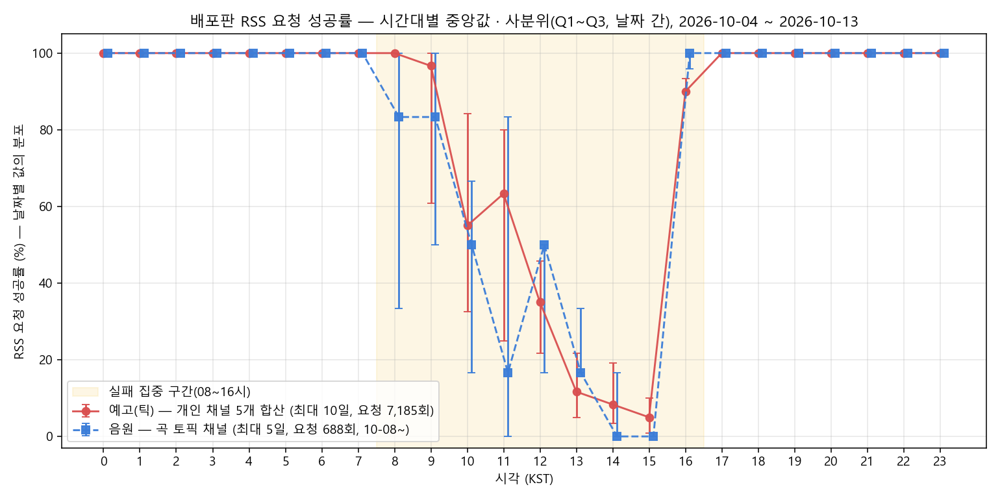
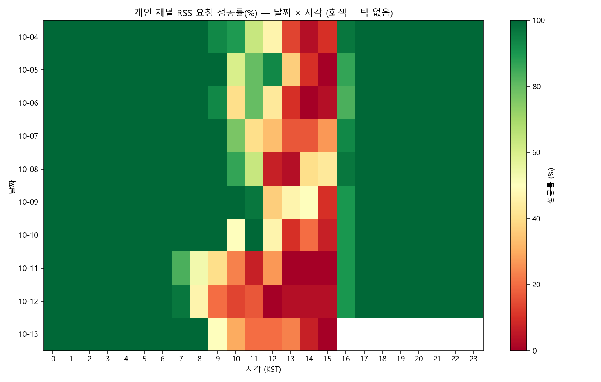

# RSS 피드 의존성 점검 보고서 — RSS 가 무력화되면 이 앱은 어떻게 되는가

작성: 2026-10-13 (v4.3 테스트 중 조사). 대상: 배포판 `mewtype-backend`(Cloud Run) 로그 30일(2026-09-13~10-13) + 코드 점검 + 이 PC 직접 조회.
관련 파일: 같은 폴더의 `rss_success_by_hour.png` · `rss_success_heatmap.png` · `hourly.csv`(집계) · `plot.py`(그림 생성), `../pubsub_probe/`(PubSub 시험 기록).

## 1. 결론 (요약)

1. **지금도 RSS 는 한국 시간 낮(08~16시)에 대부분 실패한다.** 17~07시에는 거의 100% 성공. 같은 시간대에 배포판(Cloud Run)과 이 PC 모두 실패하고, 채널·코드 경로(개인 채널 / 곡 토픽 채널)와 무관하게 같은 곡선이다 → 앱 코드 문제가 아니라 YouTube 쪽의 시간대성 제한으로 보인다(원인 확정 불가).
2. **RSS 가 완전히 없어져도 평소 방송 추적은 유지된다.** RSS 는 "새 영상 ID 발견"만 맡고 상태 판정은 `videos.list` API 가 하며, 방송 예고는 X 트윗 중계·관리 페이지·공식 스케줄 등 다른 경로로도 들어오기 때문이다.
3. **확실히 못 하게 되는 것은 둘이다.** ① **신곡 자동 감지 전체**(곡 토픽 채널 RSS 가 유일한 경로), ② **트윗·알림 없이 YouTube 에서만 새로 만든 예약·프리미어 방송의 발견**.
4. **대체 경로가 있다.** YouTube Data API `playlistItems.list`(채널 업로드 재생목록, 요청당 쿼터 1)가 예약 영상과 곡 토픽 채널 모두를 돌려주는 것을 직접 확인했다(§5). 운영자 결정(2026-10-13)은 **보류하고 관찰** — 아직 도입하지 않았다.

## 2. RSS 가 이 앱에서 하는 일

| 역할 | 위치 | 설명 |
|---|---|---|
| 개인 채널 새 영상 ID 발견 | 틱(10분)마다 `fetch_all_rss_video_ids` → 후보 집합 | 그룹 공식 채널은 제외(노래 영상이 합동 방송으로 팬아웃되는 문제). 발견한 ID 를 `videos.list`(쿼터 1)에 넘겨 상태 판정 |
| 곡 토픽 채널 신곡 감지 | `handlers._detect_new_songs` → `songs.fetch_feed_entries` | 목록에 없는 곡을 `songs.json` 에 등록(독음은 LLM). 방송 판정과 무관 |

RSS 는 **폴링**(10분마다 HTTP GET)이다. 푸시(WebSub)가 아니다. 피드는 시간과 무관하게 그 채널의 **최근 영상 15개**를 담는다(실측: 미야코 15건, 약 한 달 치).

## 3. 현재 성공률 (배포판 30일)

성공 = `Failed to fetch RSS` 경고가 없는 요청(성공은 로그가 남지 않아 부재로 간주). 분모 = 틱 처리 완료 3,974회(10-04 이후 1,437회, 그룹 채널을 RSS 에서 뺀 배포 이후).

| 작업 / 채널 | 전체 기간(09-13~) | 10-04 이후 |
|---|---|---|
| ① 예고 — 나카마치 아라레 | 3,295/3,974 (82.9%) | 1,168/1,437 (81.3%) |
| ① 예고 — 센고쿠 유노 | 3,286/3,974 (82.7%) | 1,168/1,437 (81.3%) |
| ① 예고 — 미야나가 노노카 | 3,272/3,974 (82.3%) | 1,155/1,437 (80.4%) |
| ① 예고 — 미네츠키 리츠 | 3,298/3,974 (83.0%) | 1,179/1,437 (82.0%) |
| ① 예고 — 후지 미야코 | 3,311/3,974 (83.3%) | 1,165/1,437 (81.1%) |
| **① 예고 5명 합계** | **16,462/19,870 (82.8%)** | **5,835/7,185 (81.2%)** |
| (그룹 공식 채널, 10-03 까지만 RSS) | 2,109/2,537 (83.1%) | — |
| ② 음원 — 곡 토픽 채널(10-08 14:40~) | 537/688 (78.1%) | 537/688 (78.1%) |
| **③ 전체(개인 5 + 토픽, 10-04~)** | — | **6,372/7,873 (80.9%)** |

평균 80% 대는 밤 시간의 100% 에 가려진 값이다. 시간대별로 보면 다음과 같다.

### 시간대별 성공률 (한국 시간)

- 17~07시: 중앙값·사분위 모두 100%.
- 08~12시: 에러바가 넓다(날짜마다 막히는 정도가 크게 다름). 예: 10시 중앙값 약 55%, 사분위 약 33~84%.
- 13~15시: 중앙값이 낮고 에러바가 좁다(거의 매일 막힘). 15시 중앙값 약 5%.
- 16시: 중앙값 약 90% — 매일 회복.
- 곡 토픽(음원) 선은 5일치(10-08~)뿐이라 표본이 작다. 예고 선과 같은 곡선이라는 점만 근거로 쓴다.

### 날짜 × 시각

- 10-04~10-10 은 대체로 10~15시, 10-11~10-12 는 07~08시부터 실패 구간이 앞당겨졌다. 회복 시각(16시)은 거의 고정.
- 같은 틱에 5채널이 동시에 실패하는 틱이 많다(10-04 이후 5채널 전부 실패 148틱 / 모두 성공 983틱 / 일부 실패 201틱) — 채널별 개별 문제가 아니다.

### 시간대 원인에 대한 정리

- 버스트(6개 요청이 거의 동시에 나감) 가설: 같은 요청 방식이 17~07시에는 거의 실패하지 않으므로 지지되지 않는다. 이 PC 에서 채널당 1분 간격으로 보낸 실험(15:33~15:37)도 5채널 모두 404 였다.
- 한국 08~16시 = UTC 23~07시 = 미국 서부 16~24시(PDT). 미국 저녁 피크 시간대와 겹친다. 피크 때 레거시 기능(RSS)을 제한하는지, 점검 시간인지는 **확인 불가**.
- 응답이 503 이 아니라 404·500 이라 단순 셧다운으로 보기는 어렵다(추측).

## 4. RSS 가 완전히 없어질 때의 영향 (시나리오 점검)

### ① 예고 상태 감지 (개인 채널)

| 경로 | RSS 없이 가능? |
|---|---|
| 이미 추적 중인 예고의 상태 전환 | **가능** — `videos.list` 로 계속 갱신 |
| 트윗에 영상 URL 이 있는 예고 | **가능** — URL 로 바로 확정 |
| 트윗에 URL 이 없는 예고 | **대체로 가능** — 시작 +2분에 `search.list` 로 찾음(쿼터 100) |
| 공식 일일 스케줄, 관리 페이지 입력, 회원 전용 알림 | **가능** |
| **트윗·알림 없이 YouTube 에서만 새로 만든 예약/프리미어** | **불가능** — 발견 경로가 사라짐 |
| 예고 없이 갑자기 시작한 라이브 | **불가능** (지금도 RSS 가 늦으면 못 잡음) |

### ② 새 음반(신곡) 감지

| 경로 | RSS 없이 가능? |
|---|---|
| 곡 토픽 채널 신곡 자동 감지 | **불가능** — 유일한 경로. 완전히 멈춤 |
| 관리 페이지 「곡 직접 추가」 | **가능** — 영상 URL 만 넣으면 `videos.list` 로 제목·날짜 채움(RSS 로 채우는 부분만 빠짐) |
| 관리 페이지 「지금 RSS 조회」 점검 | 불가능(조회 자체가 RSS) |

(참고: v1 수집기 `src/collector/main.py` 도 RSS 를 쓰지만 break-glass 전용이라 현행 사이트와 무관.)

## 5. 대체 경로 검증 — YouTube Data API 업로드 재생목록

방법: 채널 ID `UCxxxx` 의 업로드 재생목록 `UUxxxx` 를 `playlistItems.list`(쿼터 1/요청)로 조회. 2026-10-13 직접 실행.

| 확인 | 결과 |
|---|---|
| 현재 예정(upcoming) 상태인 리츠 예약 영상 `Pmo1Um8aCfg` | 업로드 재생목록(50건)에 **포함** |
| 현재 예정 상태인 미야코 예약 영상 `65Lq4jg4JmM` | 업로드 재생목록(50건)에 **포함** |
| 곡 토픽 채널 `UUeXzC…` | 200 OK, 59건 최신순 반환(최신 2026-09-29) |

- 쿼터: 틱당 6채널 = 6 units, 하루 약 864 units(일일 한도 10,000, 현재 틱당 사용 1).
- **한계**: 예약 영상 표본이 2건뿐. 한국 시간 낮(RSS 실패 구간)에 이 API 가 안정적인지는 **아직 시험하지 못했다**(API 키 요청이라 RSS 와 다른 경로라 기대는 되지만 미검증).
- `search.list`(eventType=upcoming)는 100 units 이라 10분 주기로는 한도를 넘는다 → 대체 수단이 아니라 최후의 수단.
- PubSub(WebSub)도 Google 의 같은 계열 레거시 프로토콜이라 RSS 보다 안전하다고 보장할 수 없다. PubSub 시험기(`../pubsub_probe/`)는 2026-10-14 약 16:40 까지 알림 수신을 기록 중.

## 6. 권고와 현재 결정

- **현재 결정(2026-10-13, 운영자)**: PubSub 전환·폴링 방식 추가 개선은 **보류하고 관찰**한다. 이미 반영된 것: 재시도(1·3초) + 지속 실패 채널 휴지(10/30/60분) + WARN 시간당 1회 + 채널별 1분 시차 폴러(v4.3-fullauto).
- 보류하는 동안 RSS 가 폐지되면 §4 의 두 가지(신곡 감지 중단, 트윗 없는 예약 방송 미발견)를 놓친다. 평소 방송은 영향이 작다.
- 보험으로 고려할 수 있는 최소 작업: RSS 실패 시(또는 항상) `playlistItems.list` 로 같은 후보 ID 를 얻는 폴백 — 쿼터 부담 작고 시간대 제한과 폐지 위험을 같이 줄임. 도입 전에 **한국 시간 낮에도 이 API 가 정상인지** 먼저 확인할 것.
- 다음 관찰·확인 항목: ① 한국 시간 17시 이후 5채널 직접 조회로 15건이 오는지, ② 큰 외부 채널(우리와 무관한 채널)의 RSS 가 낮에도 실패하는지(YouTube 전반의 제한인지), ③ 다른 리전 IP 에서의 낮 시간 성공 여부, ④ PubSub 시험기 로그에서 낮 시간대 `notify` 수신 여부.

## 7. 데이터·방법·한계

- 출처: Cloud Logging `mewtype-backend` — 경고 `Failed to fetch RSS`·`곡 RSS 조회 실패` 3,816건 + 151건, `tick done` 3,974건. 보존 기간 약 30일. `hourly.csv` 는 날짜(KST)×시각별 집계(`ticks`, `member_fetch_fail(5ch)`, `song_attempts`, `song_fail`).
- 성공률은 요청 단위다. 방송 예고는 트윗 등 다른 경로로도 들어오므로 **RSS 실패가 곧 예고 누락은 아니다.** 실제 누락량(RSS 로 처음 발견된 항목 비율)은 이 보고서에서 집계하지 않았다.
- 성공은 로그 부재로 추정했다(성공 로그 없음). 곡 토픽은 10-08 14:40 부터의 데이터.
- 그림의 중앙값·사분위는 날짜별 값(예고 10일, 음원 5일)의 분포다. 음원 선은 표본이 작아 해석에 주의.
- 가설(YouTube 의 시간대성 제한)은 간접 증거로만 지지되며 원인은 확정되지 않았다.
